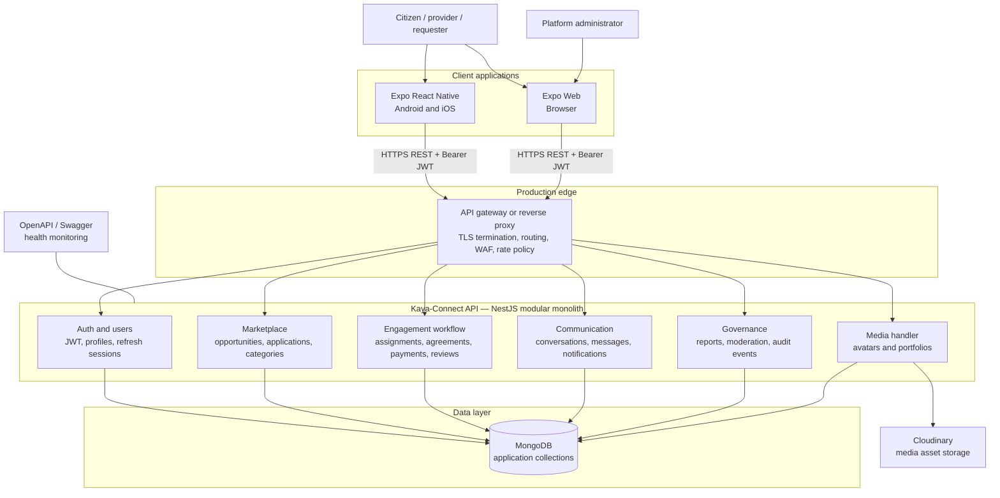
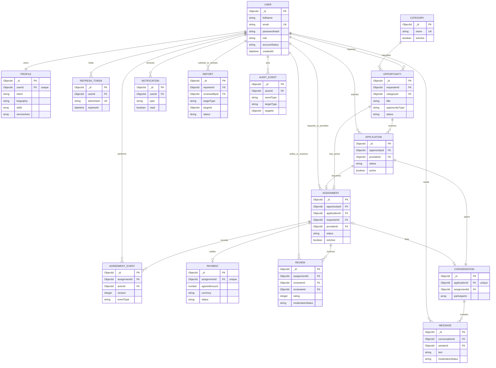

# Kaya-Connect System Architecture Specification

## 1. Purpose and scope

Kaya-Connect is a role-based opportunity marketplace. A registered citizen can
publish work or volunteer opportunities as a requester, apply to opportunities
as a provider, agree the terms of a selected engagement, communicate with the
counterparty, record payment acknowledgement, and leave a review. Administrators
moderate reports, accounts, categories, and platform content.

Opportunity discovery is limited to browsing, keyword search, and supported
filters. Automated recommendations, provider ranking, and automatic selection
are outside the system scope.

This specification describes the implementation in this repository. It treats
the `User` model as the current account and tenancy boundary: an explicit
`Organization` entity is **not currently implemented**. The Organization row in
the use-case matrix therefore describes how an organization is represented today
(a requester-owned user account) and the additions required for first-class
organization support.

### System boundaries

- **Clients:** Expo/React Native application for Android, iOS, and web.
- **Application API:** a versioned REST API under `/api/v1`.
- **Platform data:** MongoDB collections managed with Mongoose.
- **Media integration:** Cloudinary is used when its credentials are configured.
- **Operations:** Swagger/OpenAPI is served at `/docs`; liveness is exposed at
  `/api/v1/health`.

## 2. Logical architecture



### Architectural interpretation

The current backend is a **modular monolith**, not independently deployed
microservices or serverless functions. Its NestJS modules are deliberately shown
as logical handlers so their responsibilities and future extraction boundaries
are clear. An API gateway/reverse proxy is a recommended production perimeter;
the application itself provides the versioned REST API, authentication guards,
and request throttling.

## 3. Technology stack and rationale

| Layer | Technology | Use in Kaya-Connect | Why it fits |
|---|---|---|---|
| Frontend | Expo, React Native, React 19, TypeScript | One client codebase for mobile and web; file-based navigation via Expo Router | Delivers a consistent cross-platform experience and type-safe UI development. |
| API | NestJS 11, TypeScript, Express platform | REST controllers and feature modules for auth, marketplace, workflows, communications, and governance | Gives a structured module/dependency model, first-class validation and test support. |
| Persistence | MongoDB 7 with Mongoose 8 | Stores users, marketplace records, workflow state, messages, audit events, and notifications | Flexible document models suit profile and opportunity metadata while indexes protect critical invariants. |
| Authentication | JWT access tokens, hashed refresh tokens, Argon2 | Authenticates users and maintains renewable sessions | Separates short-lived API authorization from revocable server-side refresh sessions; Argon2 hardens password storage. |
| Authorization | Nest guards and role decorators | Enforces authenticated access and admin-only moderation routes | Centralizes access control before controllers run. Current roles are `user` and `admin`. |
| Validation and security | Zod, custom ObjectId/NoSQL guards, Helmet, CORS, compression, throttling | Validates DTOs and protects the HTTP boundary | Reduces malformed input, NoSQL-operator injection, abuse, and common HTTP security exposure. |
| Media | Cloudinary SDK and Multer | Handles uploaded avatars and portfolio images | Offloads binary media delivery from the API while retaining references in platform data. |
| API operations | Swagger/OpenAPI, health endpoint | Interactive API reference and readiness/liveness checks | Supports integration testing, diagnostics, and consumer onboarding. |
| Testing | Jest, Supertest, mongodb-memory-server | Unit and end-to-end API tests | Verifies validation, state transitions, and HTTP behavior without a shared database dependency. |

## 4. Core component responsibilities

### Frontend

The Expo application renders public discovery, authentication, profile,
opportunity, application, assignment, messaging, reports, and admin views. API
service modules isolate REST calls from screens. The current storage adapter uses
browser `localStorage` on web and an in-memory fallback on native platforms; a
production mobile release should replace the native fallback with platform secure
storage before treating it as persistent session storage.

### Backend API

NestJS exposes resource-oriented endpoints beneath `/api/v1`. The common request
pipeline is:

```text
Rate limit → NoSQL input guard → JWT guard → role guard → Zod validation
→ controller → service → Mongoose
```

Public exceptions are limited to registration, login, refresh, health, and
category listing. The API applies a global exception filter, Helmet headers,
compression, and configured CORS origins.

### Domain modules

| Module group | Responsibility |
|---|---|
| Auth and Users | Registration, login, logout, refresh-token lifecycle, account status, profiles, portfolio, and appeals. |
| Marketplace | Category administration; opportunity authoring, publishing, browsing, searching, updating, and closing; applications and provider selection. |
| Assignments | Agreement versioning, counterparty acceptance/rejection, status transitions, completion confirmation/concerns, and cancellation. |
| Payments and Reviews | Mutual payment acknowledgement and bilateral assignment reviews. The platform records acknowledgements; it is not a payment processor. |
| Conversations and Notifications | Application-linked conversations, moderated messages, and in-app notification records. |
| Reports, Admin, and Audit | Reporting users/listings, moderation actions, appeals, category management, and accountability events. Admins do not receive private message content. |

### Data and indexing rules

MongoDB documents use `ObjectId` references. Important constraints include a
unique user email, one profile per user, one active application by a provider per
opportunity, one active assignment per opportunity, one payment per assignment,
and one review per reviewer/reviewee/assignment combination. A refresh token has
a TTL index and is automatically removed after expiry. Opportunity title and
description support text search.

## 5. Data model

### Entity relationship diagram



`Report.targetId` is a polymorphic reference to a user or opportunity, so it is
not expressed as a database-enforced relationship in the diagram. `User` has
several roles in individual relationships (requester, provider, reviewer,
reviewee, actor); these are all references to the same collection.

## 6. Key lifecycle and security rules

1. A requester creates an opportunity in `draft`, then publishes it for
   discovery. A provider submits at most one active application to it.
2. The requester selects an application. The selected application creates an
   assignment and the listing can have only one active assignment.
3. Requester and provider propose, accept, or reject versioned agreement terms.
   The assignment then follows the enforced state machine through work,
   completion confirmation, cancellation, or concern handling.
4. Payment is a non-custodial acknowledgement record: the requester declares
   payment and the provider confirms receipt.
5. Reviews attach to completed assignments and may be hidden by moderation.
6. Any user may report a user or opportunity. Only administrators resolve,
   dismiss, suspend, deactivate, reactivate, or review appeals, and every
   enforcement action is auditable.

## 7. Role and interaction matrix

| Capability | Citizen (provider) | Citizen (requester) | Admin | Organization / institution |
|---|---:|---:|---:|---:|
| Register, authenticate, manage own profile | Yes | Yes | Yes | Via account holder today |
| Browse, search, and view published opportunities | Yes | Yes | Yes | Yes |
| Create, publish, edit, close own opportunity | No | Yes | Moderation only | Yes, through requester account |
| Apply to an opportunity; withdraw own application | Yes | No | No | Yes, through an individual account |
| Review applications and select a provider | No | Yes | Read-only moderation view | Yes, through requester account |
| Negotiate agreement and update assignment state | Assigned party only | Assigned party only | Read-only moderation view | Assigned organization delegate needed |
| Send application-linked messages | Participant only | Participant only | No private-message access | Participant account only |
| Declare / confirm payment acknowledgement | Provider confirms | Requester declares | Read-only moderation context | Account holder today |
| Write assignment review | Yes, when eligible | Yes, when eligible | Hide when required | Account holder today |
| Report user or listing | Yes | Yes | Can investigate | Yes, through account holder |
| Moderate reports, content, accounts, appeals, categories | No | No | Yes | No |
| Read audit events | No | No | Yes | No |

### First-class organization gap

To support organizations as an independent tenant, add `Organization`,
`OrganizationMembership`, and an optional `Opportunity.organizationId`. Use
membership roles such as `owner`, `manager`, and `member`; authorize actions
against the organization membership rather than the posting user alone. This
preserves the current citizen workflow while enabling delegated ownership,
offboarding, and organization-level auditability.

## 8. Production design considerations

- Place the API behind TLS termination and an API gateway/reverse proxy. Enforce
  request-size limits, WAF policy, CORS allowlists, and upstream health checks
  there; retain application throttling as a second layer.
- Store JWT secrets and Cloudinary credentials in a managed secret store. Rotate
  secrets, use a distinct secret per environment, and never expose them to the
  Expo bundle.
- Use managed MongoDB with encryption in transit and at rest, backups, point-in-
  time recovery, least-privilege access, and monitoring of unique-index errors.
- Emit structured application logs and correlate request IDs through the edge
  and API. Alert on elevated 4xx/5xx rates, authentication failures, failed
  uploads, and unhealthy health checks.
- Set media upload limits, validate MIME types server-side, and restrict
  Cloudinary transformations/delivery rules. Store only public IDs and URLs in
  business documents.
- Separate read models or extract modules only when observed load, independent
  release cadence, or isolation requirements justify the operational cost.

## 9. API and operational reference

| Item | Location / behavior |
|---|---|
| API base path | `/api/v1` |
| Interactive API reference | `/docs` |
| OpenAPI JSON | `/docs-json` |
| Health endpoint | `/api/v1/health` |
| Authentication | `Authorization: Bearer <access-token>` on protected routes |
| Public flows | register, login, token refresh, health, category listing |
| Administrative boundary | `/api/v1/admin/*`, protected by the `admin` role |

## 10. Source-of-truth references

This document was derived from the application modules, Mongoose schemas,
security setup, and client dependencies in this repository. Keep it aligned when
adding routes, changing state transitions, introducing a true organization
model, or extracting a module into an independently deployed service.
